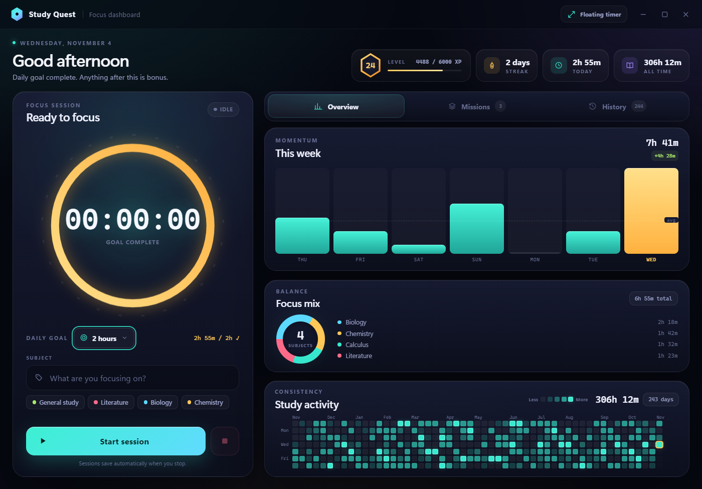
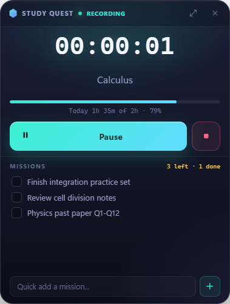

# Study Quest

A local-first Windows desktop study tracker with a game-like dashboard. Study
sessions earn XP, build streaks, and fill a GitHub-style activity calendar, while
a compact always-on-top overlay keeps the timer within reach.

**Version:** 1.4.0  
**Platform:** Windows 10/11  
**Storage:** Local JSON file. The app runs fully offline; the optional Friends
leaderboard syncs aggregate stats through a tiny server you deploy once.



## Contents

- [Features](#features)
- [Tech stack](#tech-stack)
- [Quick start](#quick-start)
- [Build a Windows installer](#build-a-windows-installer)
- [Using Study Quest](#using-study-quest)
- [Data storage and privacy](#data-storage-and-privacy)
- [Project structure](#project-structure)
- [Configuration and customization](#configuration-and-customization)
- [Scripts](#scripts)
- [Packaging notes](#packaging-notes)
- [Troubleshooting](#troubleshooting)
- [Putting this project in a Git repository](#putting-this-project-in-a-git-repository)
- [License](#license)

## Features

### Focus timer and goals

- Start, pause, resume, and stop a study session.
- Tag each session with a subject.
- Sessions shorter than 5 seconds are ignored.
- If the app closes or crashes while a timer is running, elapsed time is restored
  as a paused session the next time the app opens (capped at 12 hours).
- Choose a daily goal with the custom goal picker: no goal or 30 minutes through
  6 hours. The picker supports mouse and keyboard navigation.
- Daily progress appears in both the dashboard ring and the floating overlay,
  with a celebration when the goal is reached.

### Gamification

- Earn 1 XP for every 15 seconds studied, or roughly 100 XP per 25 minutes.
- Level up with a toast and confetti effect.
- Streaks are calculated from saved sessions, so the current streak, longest
  streak, and "studied today" state are always accurate.

### Themes

- Three built-in themes, switchable from the half-circle button in the title bar
  (keyboard navigable, Esc closes):
  - **Dark** (default) — warm graphite surfaces with a single amber accent,
    solid cards, hairline borders, and no glow or glass effects.
  - **Light** — warm paper white with the same amber accent, darkened for
    contrast.
  - **Legacy** — the original neon teal/violet look, preserved exactly.
- The choice is saved in the data file (`settings.theme`) and applied to both
  the dashboard and the floating overlay instantly; charts, the heatmap, and
  subject colors all re-tint to match the active theme.
- UI text uses the bundled Inter variable font (`assets/fonts/`, SIL Open Font
  License); the timer keeps the monospaced Cascadia font so digits never jitter.

### Friends leaderboard

- A fourth **Friends** tab: create a room and share its 6-character code, or
  join a friend's room. No accounts, no signup — the room code is the group.
- Everyone in the room sees each other's display name, today's study time,
  this week's time, streak, level, and total time, with Today/This week
  sorting and top-3 highlighting.
- Identity is a random ID generated locally plus a per-member secret issued
  once by the server (stored only as a hash) so nobody can post as someone
  else. "Leave room" deletes your row; rooms idle for 30 days are cleaned up.
- Aggregates sync when the app starts, every 10 minutes, after each saved
  session, and on manual refresh. Offline, the last snapshot stays visible
  with its age.
- The server is a tiny Cloudflare Worker + D1 database you deploy once from
  the `worker/` folder (free tier — see `worker/README.md`), or a
  zero-dependency local mock (`node worker/mock-server.js`) for testing.
  Sessions, subjects, missions, and goals never leave your machine.

### Dashboard

- **Focus panel** — timer, daily goal picker, subject input, recent subject chips,
  and start/stop controls.
- **Overview tab** — 7-day bar chart, focus mix by subject, and a GitHub-style
  study activity calendar covering the last 12 months.
- **Missions tab** — the full quest log, with active and completed tasks separated.
- **History tab** — sessions grouped by day with per-day totals, start times,
  durations, and delete/undo.
- Window controls for minimize, maximize/restore, and close.
- Closing the dashboard hides it to the system tray instead of quitting.

### Quest log

- Add, complete, reopen, and delete missions.
- Delete actions include an Undo toast.
- Clear completed missions in one action.
- Completed missions are collapsible.

### Session history

- Sessions are grouped by day.
- Each row shows subject, start time, and duration.
- Delete a session with Undo support.
- The UI displays the most recent 200 sessions; all sessions remain in the data
  file and continue contributing to stats.

### Floating overlay

- Compact, frameless, always-on-top timer.
- Includes the timer, subject field, daily-goal progress, and active missions.
- Drag it anywhere; position and visibility are remembered between launches.
- Toggle it from the dashboard or the tray menu.



### System tray

- Left-click the tray icon to toggle the floating overlay.
- Right-click for Show Dashboard, Toggle Floating Timer, Quick Start,
  Stop & Save, and Quit.
- A one-time hint explains that closing the dashboard hides it to the tray.

### Data safety

- Atomic saves: write to a temporary file, then rename over the real file.
- Loaded data is validated and sanitized.
- A corrupt JSON file is backed up as `study-quest-data.json.corrupt-<timestamp>`
  before the app starts with fresh data.
- A single-instance lock prevents two copies from writing to the same data file.

## Tech stack

- **Electron 31** — desktop shell and windows.
- **Vanilla HTML, CSS, and JavaScript** — no frontend framework or bundler.
- **CSS custom properties** — the whole visual system is token-based, with three
  full themes (`:root` dark default, `[data-theme="light"]`,
  `[data-theme="legacy"]`) in `renderer/theme.css`.
- **Inter variable font** — bundled locally (`assets/fonts/InterVariable.woff2`,
  SIL OFL 1.1); no font CDN is contacted.
- **Node.js main process** — timer engine, IPC, tray, persistence, and stats.
- **electron-builder + NSIS** — Windows installer generation.
- **Local JSON storage** — no Firebase, Firestore, SQL, or remote API.
- **Secure Electron defaults** — `contextIsolation: true`,
  `nodeIntegration: false`, and a preload bridge (`window.api`).

## Quick start

### Requirements

- Windows 10 or 11.
- [Node.js](https://nodejs.org/) LTS (Node 20 LTS is recommended) and npm.
- No account or internet connection is required after dependencies are installed.

Check that Node and npm are available:

```powershell
node -v
npm -v
```

If either command is missing, install Node.js LTS and open a new terminal.

### Install dependencies

From the project folder:

```powershell
npm install
```

This installs Electron and electron-builder. It only needs to be done once per
checkout.

### Run in development mode

```powershell
npm start
```

The dashboard opens, the floating overlay appears near the top-right of the
screen, and a tray icon is added near the clock.

## Build a Windows installer

```powershell
npm run dist
```

The installer is written to `dist/`. The current build is:

```text
dist\Study Quest Setup 1.3.1.exe
```

Run the installer to install Study Quest and create Desktop and Start Menu
shortcuts. The installer is unsigned, so Windows SmartScreen may warn you. Choose
**More info → Run anyway** if you built it yourself.

## Using Study Quest

### Start a session

1. Enter a subject, or pick one of the recent subject chips.
2. Click **Start session**.
3. Pause or resume at any time.
4. Click the stop button to save the session. Sessions under 5 seconds are not
   saved.

If you close the app during a session, the timer state is restored as paused next
time. The restore is capped at 12 hours to prevent accidental multi-day sessions.

### Change the daily goal

Click the daily goal button beside the timer ring. Choose a target from the goal
picker, or select **No goal**. The selection is saved immediately and updates the
ring, dashboard text, and overlay.

### Manage missions

Open the **Missions** tab. Add a mission from the input at the top, use the
checkbox to complete it, and use the trash button to delete it. Deleted missions
can be restored from the Undo toast.

### Review history and activity

- The **Overview** tab shows the current week, subject mix, and 12-month heatmap.
- The **History** tab shows saved sessions grouped by date.
- The activity calendar uses fixed daily intensity levels:
  - No study
  - Under 30 minutes
  - 30–60 minutes
  - 1–2 hours
  - 2+ hours

Today's cell and the calendar totals update live while a timer is running.

### Use the overlay and tray

The floating overlay can be dragged anywhere and remembers its position. Use the
tray menu to show the dashboard, toggle the overlay, start a quick session, stop
and save, or quit. Closing the dashboard does **not** quit the app; use the tray
Quit action.

## Data storage and privacy

Study Quest is local-first. It does **not** use Firebase, Firestore, a remote
database, or an account system. All user data is stored on the local machine.

### Data file location

On Windows:

```text
%APPDATA%\study-quest\study-quest-data.json
```

In PowerShell:

```powershell
$env:APPDATA\study-quest\study-quest-data.json
```

The folder is created automatically. The file is human-readable JSON, so it can
be backed up or inspected.

### What is stored

The data file contains:

- Saved study sessions (subject, local date, duration, start/end timestamps)
- Quest log items
- Recent subjects
- Daily goal and overlay settings
- Chosen theme (`dark`, `light`, or `legacy`)
- Overlay position and visibility
- Active timer state used for crash/restart recovery
- Streak metadata

Example shape:

```json
{
  "subjects": ["Calculus", "Physics"],
  "sessions": [
    {
      "id": "session-id",
      "subject": "Calculus",
      "date": "2026-11-04",
      "seconds": 3600,
      "startedAt": 1762275600000,
      "endedAt": 1762279200000
    }
  ],
  "todos": [
    {
      "id": "todo-id",
      "text": "Finish practice set",
      "done": false,
      "createdAt": 1762275600000
    }
  ],
  "streak": {
    "current": 2,
    "longest": 7,
    "lastStudyDate": "2026-11-04"
  },
  "settings": {
    "overlayBounds": null,
    "overlayVisible": true,
    "dailyGoalMinutes": 120,
    "trayHintShown": true
  },
  "activeTimer": null
}
```

### Backup and restore

To back up Study Quest:

1. Quit the app from the tray.
2. Copy `study-quest-data.json` somewhere safe.
3. To restore, replace the file while the app is closed.

To reset all progress, quit the app and delete the data file. A new file is
created the next time the app starts.

### Privacy

- No Firebase or third-party database.
- No analytics or telemetry code is included.
- Study data stays in the local application-data folder.
- The packaged app does not require an internet connection for normal use.
- The optional Friends leaderboard sends only aggregates (display name, today's
  time, weekly time, streak, level, total time) to the sync server you deploy.
  Session history, subjects, missions, and goals never leave your machine.

## Project structure

```text
study-tracker/
├─ main.js                       Electron main process, timer engine, tray, IPC, persistence
├─ preload.js                    Secure window.api bridge exposed to renderer pages
├─ sync.js                       Friends leaderboard sync client (main process)
├─ package.json                  Scripts, dependencies, electron-builder config
├─ package-lock.json             Locked dependency versions
├─ README.md                     Project documentation
├─ .gitignore                    Excludes dependencies, builds, and logs
├─ assets/
│  ├─ icon.ico                   App/installer icon
│  ├─ tray.png                   System tray icon
│  └─ fonts/                     Bundled Inter variable font (OFL)
├─ renderer/
│  ├─ dashboard.html             Main window structure
│  ├─ dashboard.css              Dashboard, tabs, calendar, and focus panel styles
│  ├─ dashboard.js               Timer UI, stats, tabs, goal picker, quests, history
│  ├─ overlay.html               Floating overlay structure
│  ├─ overlay.css                Overlay styles
│  ├─ overlay.js                 Overlay timer and mini quest UI
│  └─ theme.css                  Shared themes, colors, typography, buttons, toasts
├─ worker/                       Friends sync server (Cloudflare Worker + D1, mock server)
├─ docs/
│  └─ screenshots/               README screenshots (not part of the packaged app)
├─ dist/                         Generated installer output (ignored by Git)
└─ node_modules/                 Installed dependencies (ignored by Git)
```

## Configuration and customization

### XP rate

Edit `xpForSeconds()` in `main.js`. The current rate is 1 XP per 15 seconds:

```js
function xpForSeconds(totalSeconds) {
  return Math.floor(totalSeconds / 15);
}
```

### Level curve

Edit `levelFromXp()` in `main.js` to change how much XP each level requires.

### Daily goal presets

The default goal is 2 hours (`dailyGoalMinutes: 120`) in `defaultData()` in
`main.js`. Preset targets are in `renderer/dashboard.html` inside `#goalSelect`.

### Themes and colors

All theme colors live as CSS custom properties in `renderer/theme.css`:
dark is the `:root` default, light and legacy override it under
`[data-theme="light"]` and `[data-theme="legacy"]`. Chart and subject colors are
exposed as `--subject-1` … `--subject-7` and read by `renderer/dashboard.js`,
so recoloring a theme automatically recolors the charts. Valid values for
`settings.theme` are listed in `THEMES` in `main.js`.

### Overlay size

Edit `createOverlayWindow()` in `main.js`. The current size is 300 × 400 pixels.
Position and visibility are restored from the data file.

### Timer restore limit

Edit `MAX_RESTORE_MS` in `main.js`. It currently caps restored timer state at
12 hours.

### Minimum session length

Edit `MIN_SESSION_SECONDS` in `main.js`. Sessions below 5 seconds are ignored by
default.

### Data filename

Edit `DATA_PATH` near the top of `main.js`. Keep the file inside
`app.getPath('userData')` unless you intentionally want a different location.

## Scripts

| Command | Description |
| --- | --- |
| `npm install` | Install Electron and electron-builder |
| `npm start` | Run the app in development mode |
| `npm run dist` | Build the Windows NSIS installer into `dist/` |

There is no separate test script in the repository. The app was validated with
Electron-based smoke checks for the dashboard, overlay, calendar, tabs, goal
picker, IPC, persistence, and window sizing.

## Packaging notes

- The installer target is NSIS (`Setup.exe`).
- The installer is **unsigned**. Windows SmartScreen can warn on first launch.
- `npm run dist` sets `CSC_IDENTITY_AUTO_DISCOVERY=false` so a local unsigned
  build does not try to discover a code-signing certificate.
- `dist/` is ignored by Git. Build the installer after cloning rather than
  committing generated binaries.
- The packaged app includes `main.js`, `preload.js`, `renderer/`, `assets/`, and
  `package.json`. It does not include `docs/` screenshots or development files.

## Troubleshooting

### The tray icon is hidden

Click the **^** arrow near the Windows clock to show hidden tray icons. You can
drag the Study Quest icon out to keep it visible.

### Closing the window did not quit the app

This is intentional. Study Quest stays available in the tray. Use the tray menu
and choose **Quit** to exit fully.

### The installer triggers SmartScreen

The build is unsigned. Choose **More info → Run anyway** only if you built the
installer yourself or trust its source.

### `npm` or `node` is not recognized

Install Node.js LTS from [nodejs.org](https://nodejs.org/) and open a new
terminal so PATH changes take effect. If you use a portable Node runtime, add its
folder to PATH before running `npm install` or `npm run dist`.

### Build fails with a symbolic-link privilege error

This can happen when electron-builder extracts its Windows code-signing cache.
Enable **Developer Mode** in Windows Settings, or run the terminal as
administrator, then retry `npm run dist`. The cache is normally under:

```text
%LOCALAPPDATA%\electron-builder\Cache\winCodeSign
```

### Data appears to reset

Check that the app can write to:

```text
%APPDATA%\study-quest\study-quest-data.json
```

Also check the folder for a file named `study-quest-data.json.corrupt-*`. If the
JSON could not be parsed, the app preserves that backup and starts with a fresh
file.

### The overlay is missing

Use the dashboard's floating-timer button or the tray menu to show it. The app
remembers overlay visibility, so it may have been hidden on the previous run.

## Putting this project in a Git repository

`node_modules/`, `dist/`, and log files are already excluded by `.gitignore`.
Do **not** commit generated installers or installed dependencies.

If this folder is not already a Git repository, initialize it from the project
folder:

```powershell
git init
git add .
git commit -m "Initial commit"
```

Then create an empty repository on GitHub/GitLab and add its remote:

```powershell
git remote add origin <your-repository-url>
git branch -M main
git push -u origin main
```

Before committing, confirm your user data is not inside the project folder. The
real data file lives outside the repository in `%APPDATA%\study-quest\`.

The screenshots in `docs/screenshots/` use seeded sample data and contain no real
user information.

## License

Released under the MIT license, as declared in `package.json`.
